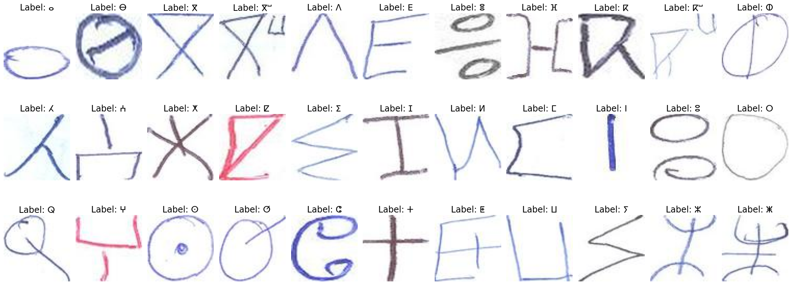
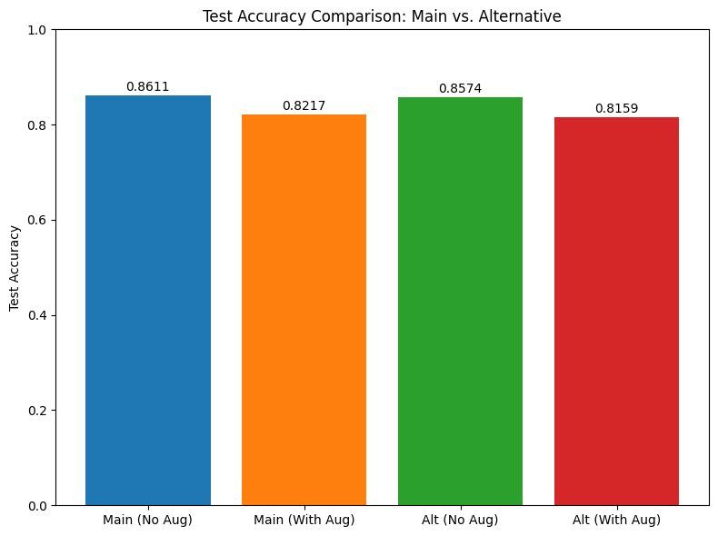

# Tifinagh Handwriting Recognition with a NumPy MLP


A multilayer perceptron written from scratch in NumPy, with no deep learning framework, to recognize handwritten Tifinagh (Amazigh) characters from the AMHCD dataset of 28,182 images across 33 classes.



## What is implemented

- Forward propagation, backpropagation and softmax classification by hand
- SGD and Adam optimizers, with L2 regularization
- K-fold cross-validation and hyperparameter search
- Data augmentation through rotation and translation

Best configuration: SGD, learning rate 0.001, L2 penalty 0.001, batch size 32.

## Results

| Training setup | Without augmentation | With augmentation |
| --- | --- | --- |
| Final model on train + validation | **86.11%** | 82.17% |
| Train only, with validation early stopping | 85.74% | 81.59% |

Augmentation lowered test accuracy in this setup.



## Getting started

```bash
pip install -r requirements.txt
jupyter notebook tifinagh_mlp_classification.ipynb
```

The dataset is retrieved through `kagglehub`.

## Author

**Yassine Houari** · [LinkedIn](https://www.linkedin.com/in/yassine-houari-/)
